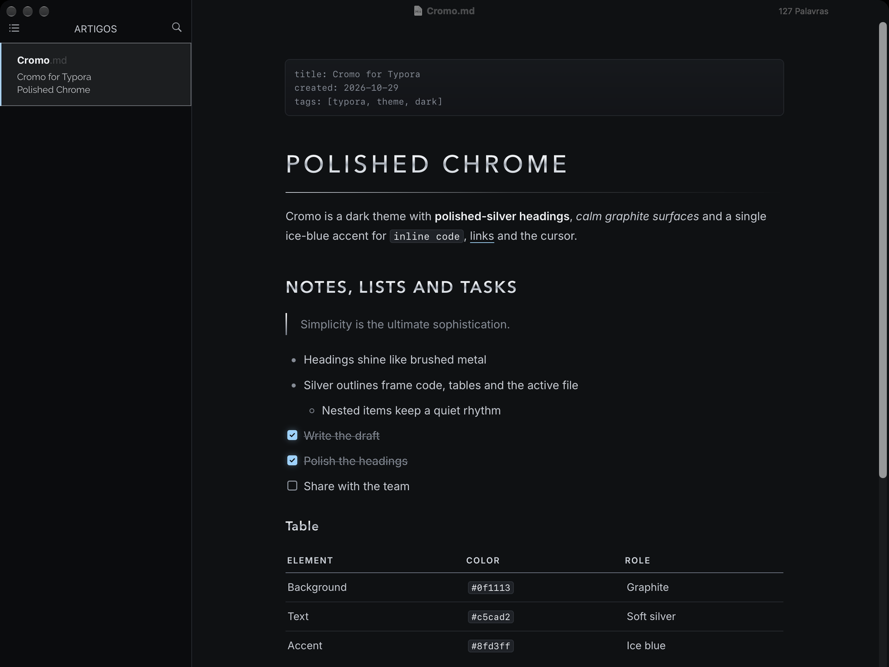

# Cromo for Typora

A futuristic, metallic dark theme for [Typora](https://typora.io): graphite surfaces, polished-silver headings and a single ice-blue accent.

## Features

- **Polished-silver headings**: H1 to H3 are filled with a brushed-metal gradient. H1 is set in spaced capitals with a thin metal rule that fades to the right.
- **Calm graphite background** (`#0f1113`) with soft silver text (`#c5cad2`) for long reading sessions.
- **One accent color**: ice blue (`#8fd3ff`) for the cursor, selection, links and checked tasks.
- **Silver outlines** on code blocks, tables and the active file in the sidebar.
- **Custom task checkboxes**, front matter block and table headers in small spaced capitals.
- **Print-friendly**: printing and PDF export switch to light colors with solid headings.

## Installation

1. Download this repository (**Code → Download ZIP**) and unzip it.
2. In Typora, open **Preferences → Appearance → Open Theme Folder**.
3. Copy `cromo.css` into that folder.
4. Restart Typora and choose **Themes → Cromo**.

## Fonts

Cromo uses fonts that ship with macOS, with fallbacks for other systems:

- Headings: Avenir Next
- Body text: Inter if installed, otherwise the system font
- Code: SF Mono, otherwise Menlo or the system monospace font

## Notes

- Designed and tested on macOS with Typora 1.14. It should work on Windows and Linux, but it has not been tested there and does not include styles for the Windows "unibody" window style.
- Mermaid diagrams use the dark Mermaid styles from Typora's built-in Night theme, and some interface styles are adapted from it.

## License

[MIT](LICENSE) © 2026 kizei23
